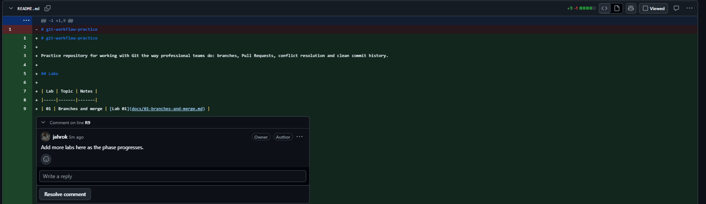
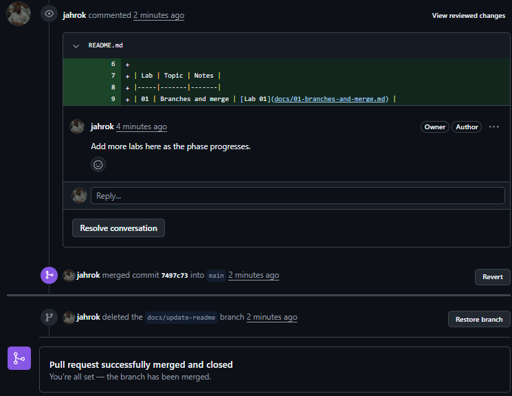

# Lab 02: Pull Requests

## Goal

Propose a change from a branch, review it on GitHub, and merge it through a Pull Request (PR) instead of merging locally.

## Key idea

A Pull Request is a GitHub feature, not a Git command. It is a request to merge one branch into another, with a space to review the diff, comment, and decide. Teams use PRs so that changes to `main` are reviewed before they are integrated.

## Steps performed

### 1. Create a branch and make two commits

```
git switch -c docs/update-readme
```

```
git add README.md
git commit -m "Add project description to README"
```

```
git add README.md
git commit -m "Add lab index table to README"
```

The `docs/` prefix describes the type of change. Other common prefixes are `feature/` and `fix/`.

### 2. Push the branch to GitHub

```
git push -u origin docs/update-readme
```

```
 * [new branch]      docs/update-readme -> docs/update-readme
branch 'docs/update-readme' set up to track 'origin/docs/update-readme'.
```

`-u` links the local branch to the remote one, so later pushes only need `git push`.

### 3. Open the Pull Request

On GitHub, **Compare & pull request** with `base: main` and `compare: docs/update-readme`. The description included a summary, the list of changes, and how to verify them.

### 4. Review the PR

The PR has three tabs:

- **Conversation:** description and activity.
- **Commits:** the two commits of the branch.
- **Files changed:** the diff, with added lines in green and removed lines in red.

I left an inline review comment on the new table. GitHub does not allow approving your own PR, which is why real teams have another person review.



### 5. Merge the PR

I used **Create a merge commit**, confirmed the merge, and deleted the branch on GitHub.



### 6. Sync the local repository

```
git switch main
git pull
```

```
Updating acadce7..7497c73
Fast-forward
 README.md | 10 +++++++++-
 1 file changed, 9 insertions(+), 1 deletion(-)
```

```
git log --oneline --graph --all
```

```
*   7497c73 (HEAD -> main, origin/main, origin/HEAD) Merge pull request #1 from jahrok/docs/update-readme
|\
| * 1d1ba51 (origin/docs/update-readme, docs/update-readme) Add lab index table to README
| * 801fb1f Add project description to README
|/
* acadce7 Add Lab 01 note: branches and merge
* c7841b5 Print a second message in hello script
* 25b06b1 Add hello script
* 21ddb7c Initial commit
```

Clean up the local branch and the stale remote reference:

```
git branch -d docs/update-readme
git fetch --prune
git branch -a
```

```
Deleted branch docs/update-readme (was 1d1ba51).
 - [deleted]         (none)     -> origin/docs/update-readme
* main
  remotes/origin/HEAD -> origin/main
  remotes/origin/main
```

## Concepts learned

- **Pull Request:** a GitHub request to merge a branch, with review and discussion built in.
- **Merge commit:** GitHub created commit `7497c73` with two parents. It records that the two commits were developed together on a branch and links them to PR #1.
- **Fast-forward locally:** my local `git pull` was a fast-forward because local `main` simply moved forward to the merge commit GitHub had already created.
- **`git push -u`:** sets the upstream so the branch tracks its remote counterpart.
- **`git fetch --prune`:** removes local references to remote branches that no longer exist.
- **Review comments:** inline comments in **Files changed** are the place to discuss specific lines.

## Notes

- Compared with Lab 01 (fast-forward, no merge commit), the PR flow keeps the branch visible in the history graph.
- The branch was deleted after the merge. Its commits remain reachable from `main`.

## Evidence

- Pull Request #1 (merged) on GitHub.
- Terminal output shown above.
- Screenshots in `docs/screenshots/`.