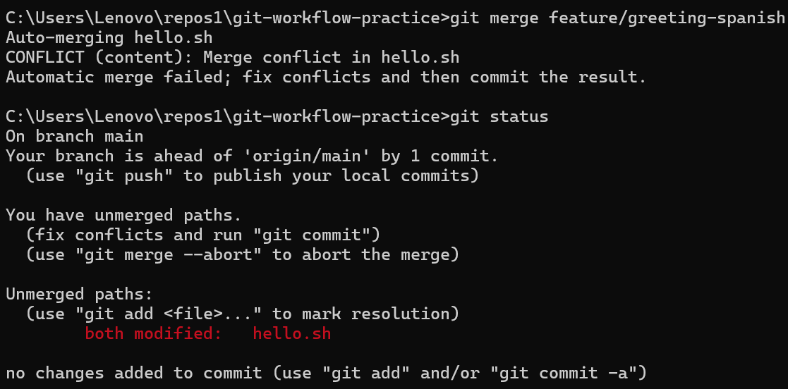
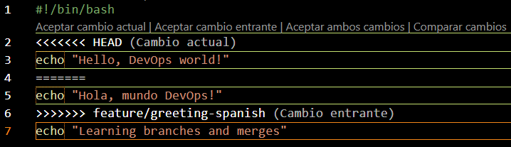
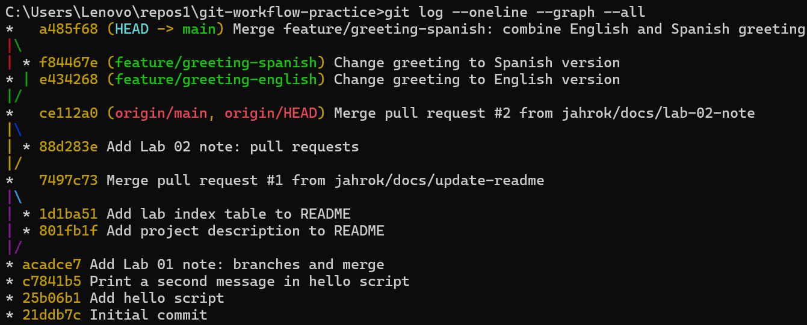

# Lab 03: Merge Conflicts

## Objective
Understand why a merge conflict happens, how to read the conflict markers, and how to resolve it manually and complete the merge.

## Environment
- Git on Windows (CMD) and VS Code
- Repository: `git-workflow-practice`

## 1. Creating the divergence
Two branches were created from the same commit (`ce112a0`), and each changed the **same line** of `hello.sh` to a different value:

- `feature/greeting-english` (`e434268`): `echo "Hello, DevOps world!"`
- `feature/greeting-spanish` (`f84467e`): `echo "Hola, mundo DevOps!"`

## 2. First merge: fast-forward
```
git merge feature/greeting-english
```
`main` had not moved, so Git only advanced the branch pointer (`Fast-forward`). No merge commit and no conflict.

## 3. Second merge: conflict
```
git merge feature/greeting-spanish
```
Now `main` already contained the English change, while the other branch changed the same line differently. Git cannot choose, so it stops:

```
CONFLICT (content): Merge conflict in hello.sh
Automatic merge failed; fix conflicts and then commit the result.
```

`git status` reported `You have unmerged paths` and `both modified: hello.sh`. At this point `git merge --abort` would undo the merge and restore the previous state.



## 4. Reading the conflict markers
Git writes both versions into the file:

```
<<<<<<< HEAD
echo "Hello, DevOps world!"
=======
echo "Hola, mundo DevOps!"
>>>>>>> feature/greeting-spanish
```

- Between `<<<<<<< HEAD` and `=======`: the version on the current branch (`main`).
- Between `=======` and `>>>>>>>`: the version from the branch being merged.



## 5. Resolving
1. Edited `hello.sh`: removed the three markers and both old lines, and kept one combined line.
2. Saved the file and checked that no markers remained.
3. `git add hello.sh` marks the conflict as resolved.
4. `git commit` completed the merge (`a485f68`).

## 6. Result
`git log --oneline --graph --all` shows the two branches diverging and joining in a merge commit with two parents (`e434268` and `f84467e`). The merged branches were deleted with `git branch -d`, and `main` was published with `git push`.



## Key takeaways
- A conflict happens when two branches change the same lines differently; Git never guesses.
- Conflict markers show both versions, and resolving means choosing, combining or rewriting, then removing every marker.
- `git add` after editing tells Git the file is resolved; `git commit` finishes the merge.
- `git merge --abort` is the safe way out if the conflict is confusing.
- Small, focused branches and frequent merges reduce conflicts.
- After resolving, review the file (and run it, if it is code) before committing.

## Next
Lab 04: `.gitignore`, `.gitattributes` and commit history.