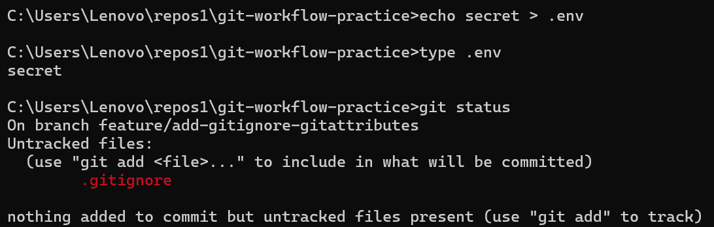
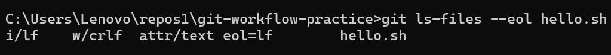
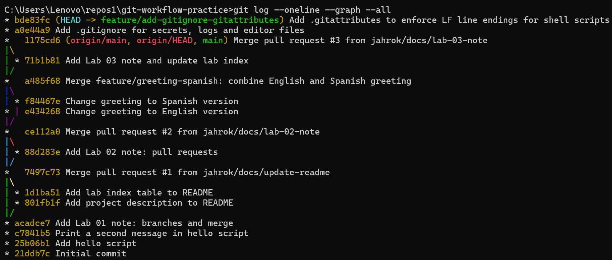

# Lab 04: .gitignore, .gitattributes and History

## Objective
Keep secrets and noise out of a repository, enforce consistent line endings, and learn to read the commit history.

## Environment
- Git on Windows (CMD) and VS Code
- Repository: `git-workflow-practice`
- Branch: `feature/add-gitignore-gitattributes`

## Part A: .gitignore
Created `.gitignore` with rules for secrets and keys (`.env`, `*.pem`, `*.key`, `id_ed25519*`), logs and temporary files (`*.log`, `*.tmp`) and editor/OS files (`.vscode/`, `.DS_Store`, `Thumbs.db`).

Test: a dummy `.env` file was created. `git status` listed only `.gitignore` as untracked, so `.env` was ignored.

```
git check-ignore -v .env
.gitignore:2:.env       .env
```

The output reads `file:line:pattern`, which shows exactly which rule matches. The dummy file was deleted afterwards.



Note: `.gitignore` only affects files that are not yet tracked. A secret that was already committed stays in the history and must be removed with history rewriting and the credential rotated.

## Part B: .gitattributes and line endings
Created `.gitattributes`:

```
* text=auto
*.sh text eol=lf
```

- `text=auto`: Git detects text files and normalizes line endings.
- `*.sh text eol=lf`: shell scripts always use LF, because CRLF breaks scripts on Linux.

Check: `git ls-files --eol hello.sh` -> `i/lf  w/crlf  attr/text eol=lf`.

- `i/lf`: the repository stores LF (correct).
- `w/crlf`: the working copy on Windows currently has CRLF.
- `attr/text eol=lf`: the rule is active.

`git add --renormalize .` produced no changes because the repository already stored LF. This resolves the CRLF warnings seen in Lab 01. The same rule is used in the `linux-secure-server` project.



## Part C: History
`git log --oneline --graph --all` shows the whole story: the fast-forward, the pull request merges, the conflict merge with two parents, and the two new commits on a straight line.

`git show --stat HEAD` shows one commit in detail (author, date, message, files changed). `git blame hello.sh` shows which commit last changed each line; line 2 points to the conflict-resolution merge commit.



Commit message conventions used in this repository:
- Short imperative summary, up to about 50 characters ("Add .gitignore ...").
- One logical change per commit.
- Explain what and why, not how.

## Issues found
- Running `git switch -c` for a branch that already existed returned `fatal: a branch named ... already exists`. Use `git switch <name>` for an existing branch and check with `git branch` first.

## Key takeaways
- `.gitignore` prevents accidental commits of secrets, logs and editor files, but does not remove what is already tracked.
- `git check-ignore -v` explains why a file is ignored.
- `.gitattributes` makes line endings consistent across Windows and Linux.
- `git ls-files --eol` shows index versus working copy line endings.
- `git log --graph`, `git show` and `git blame` answer what changed, when and why.
- Git author data may contain a name and email; review output before publishing it.

## Phase 3 summary
Branches and merge, Pull Requests, conflict resolution and repository hygiene were practiced in this repository.